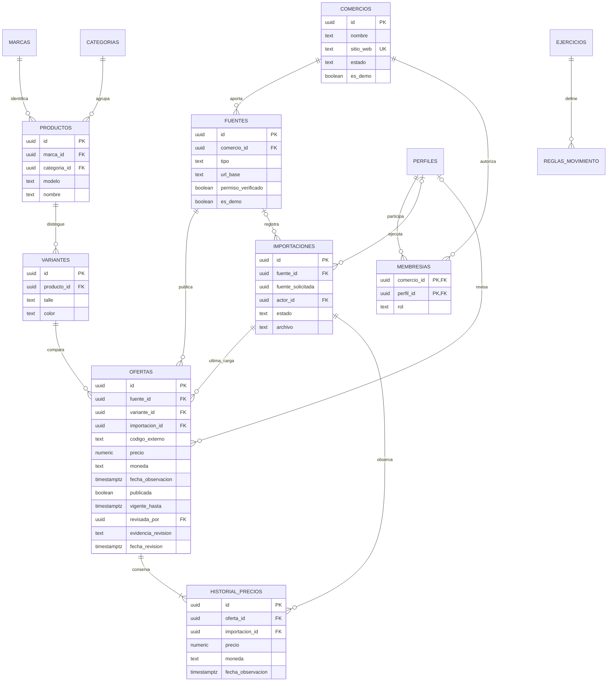

# DER del catálogo SPOT (3.1–3.6)

Modelo implementado en el esquema SQL `catalogo`. Los UUID son claves primarias. La tabla `public.profiles` ya existe en la tienda y se reutiliza para la relación de operadores; no se duplican cuentas.

En importaciones, `fuente_id` puede ser nulo si el intento pidió una fuente inexistente; `fuente_solicitada` conserva el identificador enviado. El histórico registra también URL y disponibilidad de cada observación. Una oferta conserva su identidad (fuente, código, variante y moneda); una actualización cambia precio/estado/fecha sin cambiar esa identidad.

## Normalización y decisiones

- 1FN: un talle/color por variante, un precio/moneda por oferta; no se guardan listas de talles en una celda.
- 2FN: en `membresias`, el rol depende de la relación completa comercio/perfil.
- 3FN: marcas, categorías y comercios se consultan por FK, sin copiar sus nombres en cada oferta. El comercio de una oferta se obtiene a través de su fuente, evitando dos referencias que podrían contradecirse.
- La FK compuesta `(comercio_id, es_demo)` asegura que la fuente y su comercio compartan el rótulo de datos ficticios.
- La repetición de precio/moneda/URL en el histórico representa observaciones de distinto momento, no una copia accidental del estado actual.
- Las eliminaciones no borran el histórico en cascada. Una fuente/comercio se desactiva mediante estado/permisos; el diseño de retención se completará antes de habilitar operación real.
- El registro de permisos es evidencia administrativa: un booleano por sí solo no prueba una autorización legal.

Las membresías ya autorizan la carga de fuentes del comercio; solo el admin puede asignarlas o revocarlas. `actor_id` identifica cargas con sesión; las cargas técnicas pueden tenerlo nulo. La revisión registra admin, fecha y evidencia; una nueva observación la borra y despublica. Ejercicios y reglas conservan solo su esquema, sin activar la cámara. La tienda existente conserva su propio modelo de ventas. Ver [EP-03 y operaciones](catalogo-api.md).
